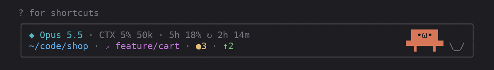

# clawd-statusbar

[](https://github.com/itsomidho/clawd-statusbar/releases)

A status bar for [Claude Code](https://claude.com/claude-code) that sits in a thin frame under the prompt, with Clawd, the little creature from Claude Code's welcome screen, frying an egg on the right while Claude works.



<sub>One turn, time-lapsed: the egg cracks in and the yolk sets while Claude thinks, reads, edits, runs a command and browses; it hands work to a background agent, and Clawd keeps going after the main turn ends until the agent is done, then serves the egg with a ✓.</sub>

## What it shows

**First line: the session**

| | |
|---|---|
| `◆ Opus 5.5` | the model |
| `CTX 5% 52k` | how full the context window is, in percent and tokens |
| `5h 18% ↻ 2h 14m` | the 5-hour usage limit and when it resets |
| `7d 62% ↻ 4d 17h` | the weekly limit, only once it is half used |
| `CPU 85%` · `RAM 91%` | only when 80% or higher, when they would explain a slow run |

**Second line: the project**

| | |
|---|---|
| `~/code/shop` | the project's folder |
| `⎇ feature/cart` | the branch, as a chip; on a narrow terminal the folder shortens first (`~/…/shop`, then `shop`) and a long branch is cut with `…`, so the branch stays |
| `●3` | files with uncommitted changes |
| `↑2` `↓1` | commits not pushed, and not pulled |
| `≡1` | stashes |
| `worktree name` | when the session runs in a linked git worktree |
| `⚠ rebasing 2/5` | git stopped partway: a rebase, merge, cherry-pick, revert or bisect |
| `!171 ✓` `#12 ✗` `CI ◔` | the branch's open GitLab MR or GitHub PR and its pipeline: green passed, red failed, yellow running; `CI` when there is a pipeline but no open MR |

Everything that is not always useful appears only when it applies, so most of the time the bar is short. On a narrow terminal, the other items that do not fit are left out whole.

**Clawd** is the creature from Claude Code's welcome screen, without his legs: two rows beside a pan.

```
▗ █▜██▛█ ▖
 ▀██████▀  \_/
```

While Claude works he shakes his fingers, the one above his left hand and then the one above his right (`▗` and `▖`), and cooks an egg: it drops into the pan, the pan glows red-hot, steam rises off it (`~ ~`, `~°~`), and the yolk sets as the turn runs long (`o`, then `◉` after 10 seconds, `●` after 30). When the turn ends the pan comes off the heat and he stands by it with a green `✓`, or a red `x` if the turn was interrupted or failed. He blinks every few seconds, while Claude works and between turns, when the pan is empty.

On his left a word says what Claude is doing, in its own colour, with the tool or how many agents run under it: `thinking`, `reading`, `editing`, `running`, `browsing`, `spawning` (an agent), `waiting` (on background agents) or `asking` (you a question).

A background agent keeps him busy after the main turn ends: he shows what the agent is doing, and serves the egg only once every agent is done. He steps aside on terminals narrower than 72 columns, and the caption on his left below 84.

## Install

In Claude Code, type:

```
/plugin install clawd-statusbar --marketplace itsomidho/claude-plugins
```

Answer `y` to add the marketplace, then choose a scope. The bar appears right away; no restart.

The [`itsomidho` marketplace](https://github.com/itsomidho/claude-plugins) also lists [clawd-tasks](https://github.com/itsomidho/clawd-tasks), a live task board; each plugin works on its own.

`/statusbar` turns it off and on.

## Requirements

- Linux or macOS (x86-64 or arm64), with `bash`, `git` and `curl`
- [`jq`](https://jqlang.org), [`gh`](https://cli.github.com) and [`glab`](https://gitlab.com/gitlab-org/cli): the plugin installs any that are missing on its first session, from each project's latest release (checked against its SHA-256 sums), into `~/.local/share/clawd-statusbar/bin`. No sudo, nothing outside that folder; tools you already have are used as they are. A failed download is tried again a day later.
- To see GitHub PR and Actions status or GitLab MR and pipeline status (self-hosted GitLab too), log in once with `gh auth login` or `glab auth login`. Until then that item stays hidden.

## Settings

Open `/plugin`, pick clawd-statusbar, and set:

| Setting | Default | |
|---|---|---|
| Clawd | on | show the mascot |

## How it works

The figures come from one script, `scripts/statusline.sh`, which reads the session's JSON on stdin; the plugin (`hooks/register.tsx`) runs it every 5 seconds and draws the result. Anything that needs the network (the pipeline status, every 60 seconds) runs in the background and the bar shows the last answer, so a slow or unreachable server never holds it up.

The script also works on its own as a classic `statusLine` command in `settings.json`, drawing the same figures as plain lines.

## Troubleshooting

**The bar shows no model, context or usage limits.** Versions before 1.8.0 read those figures with `jq`, and showed nothing on a machine without it. Update: `claude plugin update clawd-statusbar@itsomidho`, then `/reload-plugins`. The 7d limit shows only once it is half used, and the limits only when Claude Code reports them for your account.

**The bar shows `status bar: …` instead of the figures.** The script failed, and that line says why. Run it yourself to see more: `echo '{}' | bash scripts/statusline.sh` in the plugin's folder (`~/.claude/plugins/cache/itsomidho/clawd-statusbar/<version>` once installed).

**The PR, MR or pipeline item is missing.** Log in once with `gh auth login` (GitHub) or `glab auth login` (GitLab). The status is fetched in the background every 60 seconds, so it can take a minute to appear.

**Clawd doesn't show.** He steps aside on terminals narrower than 72 columns, and his caption below 84. Check the Clawd setting in `/plugin` too.

**`Host key verification failed` on install or update.** Claude Code fetched the plugin from GitHub over SSH, and this machine has no SSH key for GitHub. Either add one (`ssh-keygen -t ed25519`, add it to your GitHub account, then `ssh -T git@github.com` once to accept GitHub's host key), or have git use HTTPS for GitHub:

```
git config --global url."https://github.com/".insteadOf git@github.com:
```

Installing from a shell (`claude plugin install …`) also falls back to HTTPS by itself; updating does not.

**`/statusbar` is listed twice, or the bar draws twice.** Two copies of the plugin are loaded, such as the installed one and a working copy started with `--plugin-dir`. Run one: start Claude Code without `--plugin-dir`, or disable the installed copy with `/plugin` while you work on yours.

**The task board is above the bar, not below it (or the other way round).** With [clawd-tasks](https://github.com/itsomidho/clawd-tasks) installed, the two plugins each add their frame under the prompt, and their order depends on which one Claude Code loads first; neither plugin can choose it.

## Development

```
claude plugin validate .
claude plugin test .
```

To run your working copy instead of the installed one, start Claude Code with `claude --plugin-dir /path/to/clawd-statusbar`; edits reload when a turn ends.

## License

MIT
